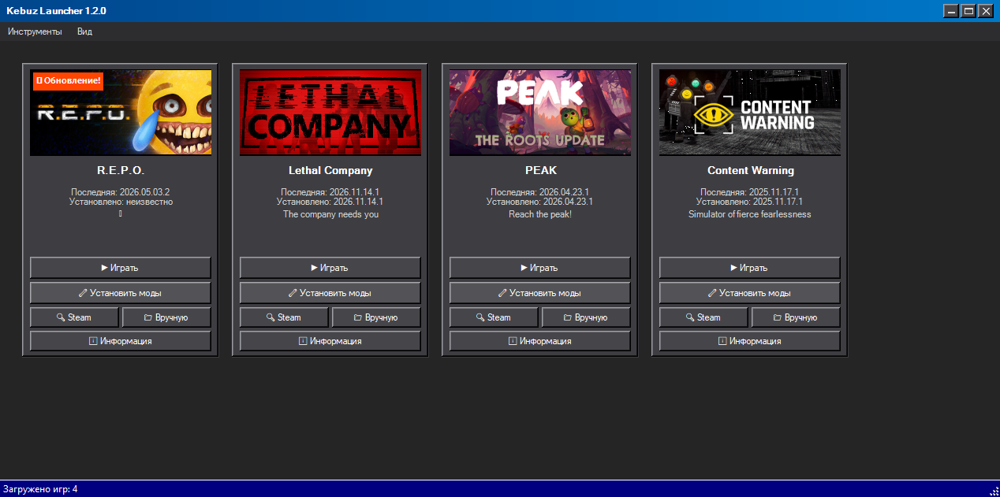

# Kebuz Launcher

Модпаки и запуск игр в одном окне.

Интерфейс в духе Windows 98. Светлая и тёмная темы.

[**Скачать лаунчер**](https://github.com/Kebuzya/KebuzLoncher/releases) | [Как пользоваться](#как-пользоваться) | [Сборка из исходников](docs/DEVELOPMENT.md#сборка)

## Что умеет

- Устанавливать модпаки и применять доступные патчи.
- Находить папку игры через Steam или использовать путь, выбранный вручную.
- Запускать Steam-игры с модами и без них.
- Создавать резервные копии модов и восстанавливать их.
- Показывать установленные и доступные версии модпаков.
- Сообщать о новой версии лаунчера. Уведомление можно скрыть до следующего обновления.

В каталоге на скриншоте: **R.E.P.O.**, **Lethal Company**, **PEAK** и **Content Warning**.
Список игр и модпаки обновляются отдельно от программы.

## Как пользоваться

1. Открой [релизы](https://github.com/Kebuzya/KebuzLoncher/releases) и скачай **KebuzLoncher.exe** из релиза лаунчера. Файл можно положить прямо на рабочий стол.
2. Выбери игру и укажи её папку кнопкой **Steam** или **Вручную**.
3. Нажми **Установить моды**, дождись завершения и выбери нужный режим в меню **Играть**.

Для работы нужны **Windows 10**, **.NET Framework 4.7.2 или новее** и установленная игра.
Игры приобретаются и устанавливаются отдельно.

## Темы и настройки

Тема переключается через **Вид**. Обе темы сохраняют объёмные кнопки, классические меню и полосу прокрутки Win98.

Настройки, резервные копии и кэш хранятся в папке пользователя.
Открыть настройки или управление резервными копиями можно через **Инструменты**.

## Для разработчиков

Лаунчер написан на C# и WinForms для .NET Framework 4.7.2.

[Сборка, каталог и подготовка исходников](docs/DEVELOPMENT.md) | [Сторонние компоненты](THIRD-PARTY-NOTICES.md)

## Лицензия

Исходный код лаунчера распространяется по [MIT](LICENSE).
Моды, модпаки и игровые материалы сохраняют лицензии и права своих авторов.
